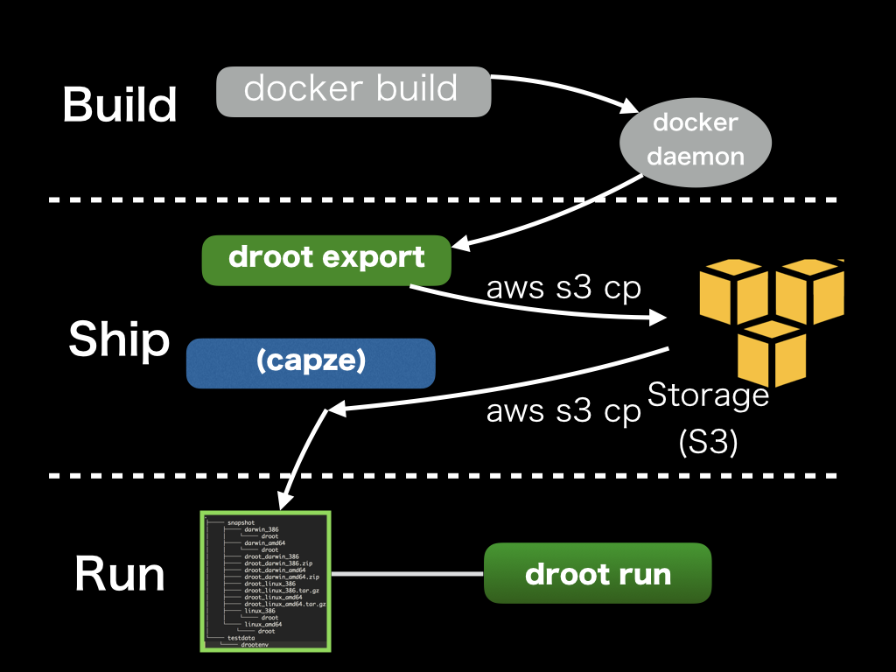

droot
=====

[English](README.md) | 日本語

[](https://github.com/yuuki/droot/actions/workflows/ci.yml)
[](https://github.com/yuuki/droot/releases)
[](https://goreportcard.com/report/github.com/yuuki/droot)
[](LICENSE)

英語版の README が正本です。内容が異なる場合は英語版を参照してください。

Droot は chroot ベースのシンプルなアプリケーションコンテナエンジンです。`docker build` でビルドし、ただの tar アーカイブとして配布し、`docker run` の代わりに `chroot(2)` で実行します。Droot の目的は、シンプルに依存関係地獄から抜け出すことです。

<a id="overview"></a>
## 概要

[Docker](https://www.docker.com) は、アプリケーションのデプロイプロセスについて Build、Ship、Run という強力なコンセプトを持っています。しかし、特に本番環境では、Docker のランタイムが複雑すぎて、現在の私たちの手に負えないケースが多くあります。Droot は、Linux の名前空間やユニオンファイルシステムといった複雑なスタックを使わない、よりシンプルなコンテナランタイムを提供します。`docker` でビルドしたコンテナイメージの実行には `chroot(2)`、Linux の `capabilities(7)`、バインドマウントというシンプルな Linux の機能を使い、その配布にはただの tar アーカイブを使います。

- **Build**: `docker build` でイメージをビルドし、`droot export` で tar アーカイブに変換します。
- **Ship**: アーカイブを任意のストレージ（Amazon S3、HTTP、rsync など）にアップロードし、各サーバーでダウンロードします。
- **Run**: `droot run` = `chroot(2)` + capabilities の削減 + バインドマウント。



Droot は意図的に、Docker のようなプロセス、ネットワーク、ユーザー、リソースの分離を**行いません**。droot のコンテナは、ホストの PID、ネットワーク、IPC、UTS の各名前空間と cgroup を共有します。信頼できないイメージを実行する前に、[セキュリティに関する考慮事項](documentation/security.md)を読んでください。

<a id="requirements"></a>
## 動作要件

| コマンド | 要件 |
|---|---|
| `droot export` | Linux または macOS と、Docker Engine API に対応したデーモン: Docker Engine、Docker Desktop、Colima、OrbStack、Podman（`podman system service`）など |
| `droot run`, `droot umount` | Linux、root 権限 |

ソースからビルドするには Go 1.26 以降が必要です。

<a id="installation"></a>
## インストール

<a id="prebuilt-binaries"></a>
### ビルド済みバイナリ

Linux（amd64、arm64、および 32 ビット OS の Raspberry Pi などで使われる 32 ビット ARMv7）と macOS（amd64 と arm64）向けの静的バイナリが、すべての [GitHub リリース](https://github.com/yuuki/droot/releases)に添付されています。アーカイブ（`droot_linux_amd64.tar.gz`、`droot_linux_armv7.tar.gz`、`droot_darwin_arm64.zip` など）としても、単体のバイナリとしても提供されています。

```console
$ curl -fsSL -o droot https://github.com/yuuki/droot/releases/latest/download/droot_linux_amd64
$ chmod +x droot && sudo mv droot /usr/local/bin/
```

<a id="verifying-a-release"></a>
#### リリースの検証

droot は root として実行されるため、インストールするものを検証してください。すべてのアセットには署名付きのビルドの来歴の構成証明（build provenance attestation）があり、すべてのアーカイブには SPDX 形式の SBOM（`*.sbom.json`）が付属しています。ダウンロードしたファイルが、このリポジトリのリリースワークフローによってリリースタグからビルドされたことは、[GitHub CLI](https://cli.github.com) で確認できます。

```console
$ gh attestation verify droot --repo yuuki/droot --signer-workflow yuuki/droot/.github/workflows/release.yml
```

バイナリは再現可能（reproducible）です。ビルド、検証、再ビルドの方法は [Releasing](documentation/development.md#releasing) を参照してください。

### go install

```console
$ go install github.com/yuuki/droot/cmd/droot@latest
```

### Homebrew

```console
$ brew tap yuuki/droot
$ brew install droot
```

> [!WARNING]
> tap の formula が更新されるまでは、droot 0.7.7 がインストールされます。このバージョンの `droot export` は、Docker API バージョン 1.29 に固定されているため、現在の Docker リリースでは動作しません。ビルド済みバイナリか `go install` を使うことをおすすめします。

<a id="from-source"></a>
### ソースから

```console
$ git clone https://github.com/yuuki/droot && cd droot
$ make build      # 静的リンクされた ./droot を生成します
```

<a id="quick-start"></a>
## クイックスタート

イメージをビルドし、そのファイルシステムをエクスポートします。

```console
$ docker build -t dockerfiles/app .
$ droot export --compress gzip --checksum -o app.tar.gz dockerfiles/app
$ aws s3 cp app.tar.gz s3://drootexamples/app.tar.gz
$ aws s3 cp app.tar.gz.sha256 s3://drootexamples/app.tar.gz.sha256
```

サーバーにデプロイして実行します（ファイルの所有者と setuid ビットが保持されるよう、root として展開してください）。

```console
$ aws s3 cp s3://drootexamples/app.tar.gz . && aws s3 cp s3://drootexamples/app.tar.gz.sha256 .
$ sha256sum -c app.tar.gz.sha256
$ sudo mkdir -p /var/containers/app
$ sudo tar -xpzf app.tar.gz -C /var/containers/app
$ sudo droot run --cp --user appuser --group appgroup --bind /var/log/app --root /var/containers/app -- command
```

`droot run` は、コマンドの終了後もマウントをそのまま残します（`--unshare` を指定した場合を除く）。新しいバージョンをデプロイする場合など、ディレクトリを削除または置き換える前に、マウントを解除してください。マウントが残ったまま削除すると、バインドマウントを通じてホストのファイルまで削除されてしまいます。

```console
$ sudo droot umount --root /var/containers/app
```

新しいバージョンは、それぞれ新しいディレクトリに展開し、それらを切り替えてデプロイします（例えば後述の capze を使います）。

systemd ユニットを含む一通りの手順については、[アプリケーションのデプロイ](documentation/deployment.md)を参照してください。

<a id="integration-with-capze"></a>
### capze との連携

[capze](https://github.com/yuuki/capze) は、Capistrano 風のディレクトリ構成でアーカイブをデプロイし、直近のリリースを保持します。

```console
$ sudo mkdir /tmp/app && sudo tar -xpzf app.tar.gz -C /tmp/app   # 上記のようにチェックサムを確認した後で
$ sudo capze --keep 5 /tmp/app /var/containers/app
```

<a id="commands"></a>
## コマンド

すべてのオプションの一覧は `droot COMMAND --help` で確認できます。

### `droot export`

```
droot export [-o FILE] [--platform PLATFORM] IMAGE[:TAG]
```

ローカルの Docker イメージのファイルシステムを、tar アーカイブとして標準出力または `FILE` にエクスポートします。droot はイメージから一時的なコンテナを作成し（ただし**起動はしません**）、そのファイルシステムをストリームで読み出してから、コンテナを削除します。`droot run` が利用できるように、イメージの設定（`ENV`、`WORKDIR`、`USER`、`ENTRYPOINT`、`CMD`、`STOPSIGNAL`）はアーカイブ内の `/.droot/config.json` として保存され、環境変数は `/.drootenv`（古いバージョンの droot が読み込むファイル）としても保存されます。distroless や `FROM scratch` のイメージなど、シェルを含まないイメージにも対応しています。

| オプション | 説明 |
|---|---|
| `-o`, `--output FILE` | アーカイブを標準出力ではなく `FILE` に書き出します（`-` は標準出力を意味します）。ファイルはアトミックに置き換えられるため、エクスポートが中断されても途中で切れたアーカイブが残ることはありません。通常の `> FILE` によるリダイレクトと同様に、新しいファイルは umask に従い、既存のファイルはモードと所有者を保持し、シンボリックリンクはたどられます。 |
| `--platform PLATFORM` | マルチプラットフォームイメージのうち、指定したバリアント（例: `linux/amd64`）をエクスポートします。 |
| `--pull` | 先に `IMAGE` をそのレジストリから pull します（`--platform` を指定した場合はそのバリアント）。`docker pull` と同様に、docker CLI の認証情報、つまりクレデンシャルヘルパー（`credHelpers`、`credsStore`）と `$DOCKER_CONFIG/config.json` の `auths` を使用します。タグを省略すると `latest` が pull されます。 |
| `--compress ALGO` | アーカイブを `gzip` または `zstd`（`zstd` コマンドを使用）で圧縮します。 |
| `--checksum` | アーカイブ（書き出したとおりのもの。圧縮の有無は問いません）の SHA-256 チェックサムを、`sha256sum` の形式で `FILE.sha256` にも書き出します。`-o FILE` が必要です。root としてアーカイブを展開する前に、`sha256sum -c FILE.sha256` で検証してください。 |
| `--reproducible` | アーカイブがイメージだけに依存するようにし、同じイメージを再度エクスポートしたときに同じバイト列が得られるようにします（キャッシュ、重複排除、署名のため）。更新時刻のうち `$SOURCE_DATE_EPOCH`（未設定の場合はイメージの作成時刻）より新しいものは、その時刻に設定されます（Docker がすべてのコンテナに作成するファイルと droot が追加するファイルの日時は、その時刻になります）。アクセス時刻と状態変更時刻は含めません。エントリの順序はデーモンが返す順序のままです。 |
| `--exclude PATTERN` | `PATTERN` に一致するエントリと、一致したディレクトリ以下のすべてを除外します。`/` を含むパターンは絶対パス（`/usr/share/doc`、`/var/cache/apk/*`）に対して、`/` を含まないパターンはベース名（`*.pyc`）に対して照合されます。構文は Go の [`path.Match`](https://pkg.go.dev/path#Match) と同じです。除外されたファイルへのハードリンクも、警告を出したうえで除外されます。複数回指定できます。 |
| `--drop-docker-files` | Docker がすべてのコンテナに追加するファイル、つまり `/.dockerenv` と、空のプレースホルダーである `/etc/hostname`、`/etc/hosts`、`/etc/resolv.conf`、`/dev/console` を除外します（`droot run` では `--cp` または `--bind-net-files` を使ってください）。 |

`--pull` を指定しない場合、イメージはローカルに存在している必要があります（先に `docker pull` または `docker build` してください）。droot はアーカイブを端末に書き出すことを拒否します。標準エラー出力が端末の場合は、そこにエクスポート済みのサイズが表示されます。

アーカイブに署名するには、お好みのツールでチェックサムファイルに署名してください（例: `cosign sign-blob --bundle app.tar.gz.sha256.sigstore.json app.tar.gz.sha256` や `minisign -Sm app.tar.gz.sha256`）。展開する前に、まず署名を、次にチェックサムを検証してください。

### `droot run`

```
droot run --root ROOT_DIR [OPTIONS] [--] [COMMAND [ARG...]]
```

`ROOT_DIR`（展開したアーカイブ）の中で `COMMAND` を実行します。`COMMAND` を省略すると、イメージの `ENTRYPOINT` に続けて `CMD` を実行します。`docker run` とは異なり、`COMMAND` を指定するとその両方が置き換えられます。エントリポイントに引数を渡すには、エントリポイントを明示的に指定してください。イメージの `USER` と `WORKDIR` が、それぞれ `--user` と `--workdir` のデフォルト値になります。これらのデフォルト値は、droot 0.8 以降の `droot export` が書き出す `/.droot/config.json` から取得されます。それより古いバージョンでエクスポートしたアーカイブでは `COMMAND` が必須で、特に指定しない限り droot は root として `/` で実行します。

droot は次の順に処理を行います。

1. 必要に応じて、ホストの `/etc/group`、`/etc/passwd`、`/etc/resolv.conf`、`/etc/hosts` を `ROOT_DIR` にコピーします（`--cp`）。
2. `/proc` に `proc` をマウントし、ホストの `/sys` を `/sys` に（rslave マウントとして）バインドマウントします。Docker と同様に、それらの機密性の高いファイルをマスクし、`/proc/sys`、`/proc/sysrq-trigger`、`/proc/irq`、`/proc/bus`、`/proc/fs`、`/sys` を読み取り専用にします（`--no-mask` を指定しない場合）。さらに、`--bind`/`--robind`/`--tmpfs` のマウント（親から順に）と `--bind-net-files` のマウントを行います。
3. `/var` が存在し `/var/lock` が存在しない場合は `/var/lock -> ../run/lock` のシンボリックリンクを作成します。また、Docker と同様に `/dev` に次のものを用意します（`/dev` がマウントポイントである場合（例: `--bind /dev`）は、`/dev` には何もしません）。デバイス `null`、`zero`、`full`、`random`、`urandom`、`tty`（所有者 root、モード 0666）、シンボリックリンク `fd -> /proc/self/fd`、`stdin`、`stdout`、`stderr`、`ptmx -> pts/ptmx`、`/dev/pts` 上のプライベートな `devpts` インスタンス（疑似端末）、`/dev/shm` 上の 64 MiB の tmpfs。
4. `ROOT_DIR` に `chroot` します。
5. `CAP_CHOWN`、`CAP_DAC_OVERRIDE`、`CAP_FOWNER`、`CAP_SETGID`、`CAP_SETUID`、`CAP_NET_BIND_SERVICE`（`--cap-add`/`--cap-drop` で調整できます）以外のすべての capability をバウンディングセットから削除し、継承可能（inheritable）セットとアンビエント（ambient）セットを空にします（`--no-dropcaps` を指定しない場合）。
6. 指定されたユーザーとグループに切り替えます。
7. 作業ディレクトリに移動し、イメージの環境変数（`/.droot/config.json` の `Env` を `/.drootenv` で上書きしたもの）を `--env-file`、次に `--env` で上書きした環境で `COMMAND` を実行します。`PATH`（`/usr/local/sbin:/usr/local/bin:/usr/sbin:/usr/bin:/sbin:/bin`）、`HOME`、`USER`、`LOGNAME`（`ROOT_DIR/etc/passwd` にあるそのユーザーのエントリから取得します。エントリがない場合は `HOME=/`）は、未設定であれば設定されます。droot は `COMMAND` で*自分自身を置き換える*ため、終了ステータスとシグナルは `COMMAND` のものになります。

| オプション | 説明 |
|---|---|
| `--config FILE` | オプションを `FILE`（例: `/etc/droot/app.toml`）から読み込みます。systemd ユニットには `droot run --config FILE` と書くだけで済みます（[`examples/droot/app.toml`](examples/droot/app.toml) を参照）。キーはオプションの長い名前（`root`、`user`、`bind`、`unshare` など）で、`command` で `COMMAND` を指定します。値は文字列、`true`/`false`、文字列の配列で、TOML のサブセットとして解釈されます（それ以外はエラーになります）。コマンドラインで指定したオプションが優先され、繰り返し指定できるオプションはファイルの値に追加されます。 |
| `-r`, `--root ROOT_DIR` | chroot するルートディレクトリ（必須。コマンドラインまたは `--config` で指定）。 |
| `-u`, `--user USER` | 実行するユーザーの名前または ID。デフォルトはイメージの `USER`（`USER app:staff` のようにグループも指定されている場合があります）、それがなければ droot 自身のユーザー（root）です。名前はまず `ROOT_DIR/etc/passwd` で検索され、次にホスト上（`/etc/passwd`、次に LDAP や SSSD など NSS が提供するユーザーのための `getent passwd`）で検索されます。そのため、名前がどのユーザーに対応するかはイメージが決めます（`root` 以外の名前が uid 0 に対応する場合、droot は警告を出します）。数値の ID はイメージに依存しません。未知の数値 ID も受け付けます。 |
| `-g`, `--group GROUP` | 実行するグループの名前または ID。`--user` と同様に検索されます（`ROOT_DIR/etc/group`、ホストの `/etc/group`、`getent group`）。デフォルトは `--user` のプライマリグループです。`ROOT_DIR/etc/passwd` にエントリのない数値の `--user` の場合は、Docker と同様に droot 自身のグループ（通常は 0。警告が出ます）になります。 |
| `-w`, `--workdir DIR` | `COMMAND` の作業ディレクトリ。コンテナ内の絶対パスで指定します。デフォルトはイメージの `WORKDIR`、それがなければ `/` です。ディレクトリは存在している必要があります。 |
| `-b`, `--bind SRC[:DEST][:OPTS]` | ホストの `SRC`（ディレクトリまたはファイル）を、コンテナ内の `DEST`（デフォルト: `SRC`）にバインドマウントします。`OPTS` は `ro`（読み取り専用）、`rw`（デフォルト）、`rbind`（`SRC` 以下のマウントもバインドします。`ro` と組み合わせると、それらもすべて読み取り専用になります）のカンマ区切りのリストです。例: `--bind /srv/data:/data:ro`、`--bind /srv:rbind`。最後の部分がこのようなリストでない場合は `DEST` の一部とみなされます（`--bind /a:/b:c` は `/b:c` にマウントします）。複数回指定できます。 |
| `--robind SRC[:DEST][:OPTS]` | `--bind SRC:DEST:ro` と同じです。複数回指定できます。 |
| `--tmpfs PATH[:OPTS]` | コンテナ内の `PATH` に新しい tmpfs をマウントします（例: `--tmpfs /tmp --tmpfs /run`）。`OPTS` は、マウントフラグ（`ro`、`rw`、`nosuid`/`suid`、`nodev`/`dev`、`noexec`/`exec`、`noatime`。デフォルトは `nosuid,nodev,noexec`）と、`size=64m`、`mode=1777`、`uid=`、`gid=` などの [tmpfs オプション](https://man7.org/linux/man-pages/man5/tmpfs.5.html)のカンマ区切りのリストです。`--tmpfs /dev/shm:OPTS` はデフォルトの `/dev/shm` を置き換えます。複数回指定できます。 |
| `--cp`, `--copy-files` | ホストの `/etc/group`、`/etc/passwd`、`/etc/resolv.conf`、`/etc/hosts` をコンテナにコピーします。 |
| `--bind-net-files` | ホストの `/etc/resolv.conf` と `/etc/hosts` を、コンテナ内の同じパスに読み取り専用でバインドマウントします。これにより `COMMAND` は、`--cp` でコピーされたスナップショットではなく、それらのファイルへのその後の変更（例: DHCP リースの更新後）を参照できます。実行のたびに現在のファイルが新たにバインドされます。ただし、ファイルのバインドマウントが追従するのは*その場で*行われた変更だけである点に注意してください。`COMMAND` の実行中に `rename(2)` で置き換えられたホストのファイル（一部の DHCP クライアントや `resolvconf`）は、次回の実行時にしか反映されません。`--cp` と併用すると、コピーされるのは `/etc/group` と `/etc/passwd` だけになります。 |
| `-e`, `--env KEY[=VALUE]` | 環境変数を設定します。`/.drootenv` と `--env-file` の値を上書きします。`KEY` だけを指定すると、`docker run -e KEY` と同様に droot 自身の環境から値を取得し、未設定の場合はその変数を設定しません（`sudo` 経由の場合は `sudo --preserve-env=KEY` で引き継いでください）。複数回指定できます。カンマは区切り文字ではありません。 |
| `--env-file FILE` | ホストの `FILE` から環境変数を読み込みます。`KEY=VALUE` 形式の行（`/.drootenv` と同じ形式。`#` で始まる行はコメント行です）と、droot の環境から値を取得する `KEY` だけの行を記述できます。`/.drootenv` を上書きし、後に指定したファイルが先に指定したファイルを上書きします。複数回指定できます。 |
| `--cap-add CAP` | capability `CAP` もバウンディングセットに残します。`CAP_` の有無や大文字小文字を問わない名前（`NET_RAW`、`cap_sys_ptrace`）、または `ALL` を指定します。複数回指定できます。 |
| `--cap-drop CAP` | デフォルトで残す capability から `CAP` を削除します。`ALL` を指定するとそのすべてを削除します（その場合、`--cap-add` で指定したものが追加し直されます）。複数回指定できます。 |
| `--no-dropcaps` | capability を削除しません（危険）。 |
| `--ulimit NAME=SOFT[:HARD]` | `COMMAND` のリソース制限（`setrlimit(2)`）を設定します。名前は `docker run --ulimit` と同じで、`nofile`、`nproc`、`core`、`memlock`、`stack`、`as`、`cpu` などです。`HARD` のデフォルトは `SOFT` です。`unlimited` または `-1` は無制限を意味します。複数回指定できます。 |
| `--unshare` | マウントをプライベートなマウント名前空間の中で行います。マウントはホストからは見えず、`COMMAND` とその子プロセスがすべて終了すると消え、`droot umount` も不要です。後からホストで行われたマウントは、引き続きコンテナに伝播します。 |
| `--unshare-ipc` | `COMMAND` をプライベートな IPC 名前空間（System V IPC オブジェクト、POSIX メッセージキュー）で実行します。 |
| `--hostname NAME` | ホスト名が `NAME` であるプライベートな UTS 名前空間で `COMMAND` を実行します（`NAME` は `HOSTNAME` のデフォルト値にもなります）。ホスト自体の名前は変更されません。 |
| `--read-only` | `COMMAND` から見て `ROOT_DIR` を読み取り専用にします（バインドマウントと tmpfs はそれぞれのモードを保ちます。書き込みが必要な場所には `--tmpfs /tmp` や `--bind` などを追加してください）。読み取り専用のマウントが `COMMAND` とともに消えるように、`--unshare` も有効になります。 |
| `--no-mask` | `/proc` と `/sys` をそのままにします。機密性の高いファイルのマスクも、`/proc/sys` や `/sys` などの読み取り専用化も行いません（危険）。以前の実行で行われたマスクは、`droot umount` するまで残ります。 |
| `--no-new-privileges` | `no_new_privs` フラグを設定します。setuid プログラム（`su`、`sudo` など）やファイル capability によって `COMMAND` に権限が付与されることはなくなります。デフォルトで有効です。`sudo` や `su` を必要とするアプリケーションでは `--no-new-privileges=false` で無効にできます。 |
| `--seccomp PROFILE` | `default` を指定すると、Docker のデフォルトプロファイルと同様に、アプリケーションが本来行う必要のないシステムコールを拒否する seccomp フィルタを設定します。名前空間の作成（`unshare`、`setns`、名前空間フラグ付きの `clone`）、マウント、モジュールやカーネルのロード、キーリング、`bpf`、perf イベント、`userfaultfd`、io_uring、時刻の設定、スワップ、再起動などが `EPERM` で失敗します（`clone3` は C ライブラリが `clone` を使うよう `ENOSYS` で失敗します）。amd64、arm64、arm、386 に対応しています。他のアーキテクチャのプログラム（64 ビットカーネル上の 32 ビットプログラムなど）はシステムコールを一切実行できません。デフォルトの `unconfined` ではフィルタを設定しません。 |

注意事項:

- `--bind`/`--robind` に指定したパスと `--cp` でコピーされるファイルは、`ROOT_DIR` の*中で*解決されます。イメージ内のシンボリックリンクによって、ホストのファイルシステムにリダイレクトされることはありません。バインドマウントのマウント先を `ROOT_DIR` 自体にすることはできず、`/proc` や `/sys` の中にすることもできません。
- 補助グループ（supplementary groups）は、`ROOT_DIR/etc/group` でそのユーザーをメンバーとして挙げているグループです。
- 以前の実行で残ったマウントは、そのまま再利用されます。`--tmpfs` や `--bind` のオプションを変更するには、先に `droot umount` を実行してください。
- セットアップに失敗した場合や、`COMMAND` が見つからないかユーザーが実行できない場合、失敗した実行で作成されたマウントは削除されます。以前の実行によるマウントは残ります。ユーザーを切り替えた後に `execve(2)` 自体が失敗した場合（ELF インタプリタがない場合など）に限り、警告とともにマウントが残ります。
- 同じ `ROOT_DIR` に対して同時に実行された `droot run` と `droot umount` は、`COMMAND` が実行されるまで、順番に処理されます（root だけがアクセスできる `/run/droot` 内のファイルに対する `flock(2)`）。
- `COMMAND` は、droot を起動したシェルの `PATH` ではなく、コンテナの環境の `PATH`（ない場合は `/usr/local/sbin:/usr/local/bin:/usr/sbin:/usr/bin:/sbin:/bin`）から検索されます。
- イメージの `STOPSIGNAL` は保存されますが、使用されません。droot はスーパーバイザーではないためです。たとえば systemd ユニットの `KillSignal=` として設定してください。
- `--cp` を使うと、コンテナの `/etc/passwd` と `/etc/group` はホストのものになります。そのため、イメージの `USER` はホストにも存在するか、`--user` で上書きする必要があります。

<a id="resource-limits"></a>
#### リソース制限

droot は `--ulimit` によるプロセスごとの制限は設定しますが、cgroup は作成しません。メモリ、CPU、タスク数は、すでに cgroup を管理しているサービスマネージャーで制限してください。単発のコマンドの場合は次のようにします。

```console
$ sudo systemd-run --scope -p MemoryMax=1G -p CPUQuota=50% -p TasksMax=512 \
    droot run --root /var/containers/app -- app
```

または、アプリケーションを実行するユニットで次のように設定します。

```ini
[Service]
ExecStart=/usr/local/bin/droot run --root /var/containers/app --user app -- app
MemoryMax=1G
CPUQuota=50%
TasksMax=512
LimitNOFILE=65536
```

ユニットの `LimitNOFILE=` やその他の `Limit*=` の設定も、`--ulimit` で上書きしない限り `COMMAND` に継承されます。

### `droot umount`

```
droot umount --root ROOT_DIR
```

`ROOT_DIR` 以下のすべてのマウントポイントを、深いものから順に遅延アンマウント（lazy unmount）し、アンマウントできないものがあれば失敗します。`ROOT_DIR` 自体は決してアンマウントされないため、`ROOT_DIR` を独立したファイルシステムにすることもできます。このコマンドは冪等であり、`/` は拒否します。

### `droot status`

```
droot status --root ROOT_DIR
```

`ROOT_DIR` 以下のマウントポイント（`droot umount` が解除するもの）と、ルートディレクトリが `ROOT_DIR` であるプロセス（`droot run` で起動された `COMMAND` とその子プロセス）を、PID、uid、コマンドラインとともに一覧表示します。

```console
$ sudo droot status --root /var/containers/app
Mounts below /var/containers/app: 17
  MOUNT POINT      TYPE      SOURCE     OPTIONS
  /dev/pts         devpts    devpts     rw,nosuid,noexec,relatime
  /dev/shm         tmpfs     tmpfs      rw,nosuid,nodev,noexec,relatime
  /proc            proc      proc       rw,nosuid,nodev,noexec,relatime
  /proc/acpi       tmpfs     tmpfs      ro,nosuid,nodev,noexec,relatime
  /proc/keys       devtmpfs  devtmpfs   ro,relatime
  ...
  /sys             sysfs     sysfs      ro,relatime
  /var/log/app     ext4      /dev/sda1  rw,relatime

Processes in /var/containers/app: 1
  PID   UID   COMMAND
  4242  1500  /usr/local/bin/app --port 8080
```

`droot run --unshare` のプロセスは一覧に表示されますが、そのマウントはプライベートであるため表示されません。

<a id="global-options"></a>
### グローバルオプション

| オプション | 説明 |
|---|---|
| `-D`, `--debug` | デバッグメッセージを標準エラー出力に出力します。`DROOT_DEBUG=1` でも有効になります。 |
| `-q`, `--quiet` | エラーのみを出力し、警告、情報メッセージ、進捗は出力しません。`DROOT_QUIET=1` でも有効になります。 |
| `--log-format FORMAT` | 標準エラー出力に出すメッセージの形式です。`text`（デフォルト）または `json` を指定します。`json` では、ログコレクター向けに 1 行につき 1 つの [`log/slog`](https://pkg.go.dev/log/slog) の JSON オブジェクト（`{"time":...,"level":"WARN","msg":...}`）を出力します。`DROOT_LOG_FORMAT` でも設定できます。 |
| `-v`, `--version` | バージョンを、コミットとその日付とともに表示します。 |

すべてのオプションは、[コマンドラインリファレンス](documentation/cli.md)と man ページ（[`documentation/droot.1`](documentation/droot.1)。リリースアーカイブにも含まれており、`man -l droot.1` で表示できます）に記載されています。

<a id="shell-completion"></a>
### シェル補完

`droot completion bash|zsh|fish` は補完スクリプトを出力します。

```console
$ source <(droot completion bash)     # ~/.bashrc に記述
$ source <(droot completion zsh)      # ~/.zshrc の compinit の後に記述
$ droot completion fish > ~/.config/fish/completions/droot.fish
```

<a id="choosing-the-docker-daemon"></a>
## Docker デーモンの選択

`droot export` は、`docker` CLI と同じ方法でデーモンを探します。

1. `DOCKER_HOST`（`unix:///path/to/docker.sock`、`tcp://host:2376`、`ssh://[user@]host[:port]`）。あわせて `DOCKER_TLS_VERIFY`（TLS を使用し、デーモンの証明書を検証します）、`DOCKER_TLS`（検証なしで TLS を使用します）、`DOCKER_CERT_PATH`（`ca.pem`、`cert.pem`、`key.pem`。デフォルトは `~/.docker`）を使用します。
2. それ以外の場合は、`DOCKER_CONTEXT` で指定された [docker コンテキスト](https://docs.docker.com/engine/manage-resources/contexts/)。
3. それ以外の場合は、`$DOCKER_CONFIG/config.json`（デフォルトは `~/.docker`）から読み取った現在の docker コンテキスト（`docker context use ...`）。
4. それ以外の場合は `unix:///var/run/docker.sock`。

`DOCKER_API_VERSION` で API バージョンを固定できます。デフォルトでは、droot はデーモンが提示するバージョンを使用します。例:

```console
$ DOCKER_HOST=unix://$XDG_RUNTIME_DIR/podman/podman.sock droot export -o app.tar localhost/app   # Podman
$ DOCKER_HOST=tcp://192.0.2.10:2376 DOCKER_TLS_VERIFY=1 DOCKER_CERT_PATH=~/.docker/remote droot export app > app.tar
```

`ssh://` のホストを指定した場合、droot は docker CLI と同様に、接続ごとに `ssh [-l user] [-p port] host docker system dial-stdio` を実行します。そのため、ローカルの `ssh` がパスワードの入力なしで（鍵やエージェントを使って）ログインできること、そしてリモートホストに `docker` コマンドがあることが必要です。

```console
$ DOCKER_HOST=ssh://deploy@build.example.com droot export -o app.tar app
```

<a id="documentation"></a>
## ドキュメント

- [アプリケーションのデプロイ](documentation/deployment.md): `docker build` から systemd サービスまで（[ユニットの例](examples/systemd)付き）
- [コマンドラインリファレンス](documentation/cli.md)
- [droot の仕組み](documentation/architecture.md)
- [セキュリティに関する考慮事項](documentation/security.md)
- [開発ガイド](documentation/development.md)
- [既知の問題とアイデア](documentation/roadmap.md)
- [変更履歴](CHANGELOG.md)

<a id="presentations-japanese"></a>
## 発表資料

- [Dockerとchrootを組み合わせたシンプルなコンテナデプロイツール](http://blog.yuuk.io/entry/droot)
- [Droot Internals](https://speakerdeck.com/yuukit/droot-internals)

<a id="contribution"></a>
## コントリビューション

1. フォークします（[https://github.com/yuuki/droot/fork](https://github.com/yuuki/droot/fork)）
1. フィーチャーブランチを作成します
1. 変更をコミットします
1. ローカルの変更を master ブランチに対してリベースします
1. `make lint test`（`run`、`umount`、`export` を変更した場合は `make integration-test` も）を実行し、成功することを確認します
1. 新しいプルリクエストを作成します

詳細は[開発ガイド](documentation/development.md)を参照してください。

<a id="license"></a>
## ライセンス

[MIT](LICENSE)。依存ライブラリのライセンスは [LICENSE_OF_DEPENDENCIES.md](LICENSE_OF_DEPENDENCIES.md) に記載されています。

<a id="author"></a>
## 作者

[y_uuki](https://github.com/yuuki)
