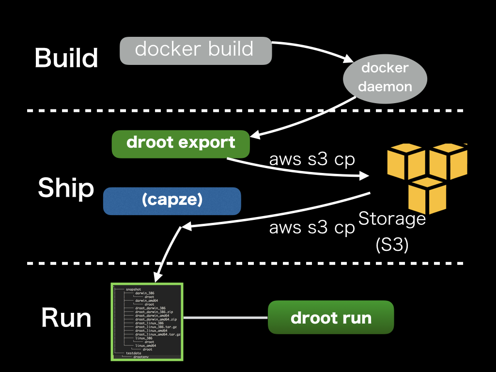

droot
=====

[](https://github.com/yuuki/droot/actions/workflows/ci.yml)
[](https://github.com/yuuki/droot/releases)
[](https://goreportcard.com/report/github.com/yuuki/droot)
[](LICENSE)

Droot is a simple chroot-based application container engine: build with
`docker build`, ship a plain tar archive, and run it with `chroot(2)` instead of
`docker run`. Droot aims to simply escape dependency hell.

## Overview

[Docker](https://www.docker.com) has a powerful concept about an application
deployment process: Build, Ship, Run. But there are many cases where the Docker
runtime is too complicated and beyond our current capabilities, especially in
production. Droot provides a simpler container runtime without complicated
stacks such as Linux namespaces and union file systems. It relies on simple
Linux features — `chroot(2)`, Linux `capabilities(7)` and bind mounts — to run
a container image built by `docker`, and on plain tar archives to ship it.

- **Build**: build an image with `docker build` and turn it into a tar archive with `droot export`.
- **Ship**: upload the archive to any storage (Amazon S3, HTTP, rsync, ...) and download it on your servers.
- **Run**: `droot run` = `chroot(2)` + dropped capabilities + bind mounts.



Droot deliberately does **not** isolate processes, networks, users or resources
the way Docker does: a droot container shares the host's PID, network, IPC and
UTS namespaces and cgroups. Read [Security considerations](documentation/security.md)
before running untrusted images.

## Requirements

| Command | Requirements |
|---|---|
| `droot export` | Linux or macOS, and a daemon speaking the Docker Engine API: Docker Engine, Docker Desktop, Colima, OrbStack, Podman (`podman system service`), ... |
| `droot run`, `droot umount` | Linux, root privileges |

Building from source requires Go 1.26 or later.

## Installation

### Prebuilt binaries

Static binaries for Linux and macOS (amd64 and arm64) are attached to every
[GitHub release](https://github.com/yuuki/droot/releases), both as tar.gz
archives and as bare binaries:

```console
$ curl -fsSL -o droot https://github.com/yuuki/droot/releases/latest/download/droot_linux_amd64
$ chmod +x droot && sudo mv droot /usr/local/bin/
```

### go install

```console
$ go install github.com/yuuki/droot/cmd/droot@latest
```

### Homebrew

```console
$ brew tap yuuki/droot
$ brew install droot
```

### From source

```console
$ git clone https://github.com/yuuki/droot && cd droot
$ make build      # produces ./droot, statically linked
```

## Quick start

Build an image and export its file system:

```console
$ docker build -t dockerfiles/app .
$ droot export dockerfiles/app | gzip -c | aws s3 cp - s3://drootexamples/app.tar.gz
```

Deploy and run it on a server:

```console
$ sudo droot umount --root /var/containers/app   # it is safe to umount before run if you use --bind
$ mkdir -p /tmp/app /var/containers/app
$ aws s3 cp s3://drootexamples/app.tar.gz - | tar -xpzf - -C /tmp/app
$ sudo mv -T /tmp/app /var/containers/app
$ sudo droot run --cp --user appuser --group appgroup --bind /var/log/app --root /var/containers/app -- command
```

`droot run` leaves its mounts in place after the command exits. Remove them
before deleting or replacing the directory:

```console
$ sudo droot umount --root /var/containers/app
```

### Integration with capze

[capze](https://github.com/yuuki/capze) deploys archives in a Capistrano-like
directory layout and keeps the last releases:

```console
$ aws s3 cp s3://drootexamples/app.tar.gz - | tar -xpzf - -C /tmp/app
$ capze --keep 5 /tmp/app /var/containers/app
```

## Commands

Run `droot COMMAND --help` for the full list of options.

### `droot export`

```
droot export [-o FILE] [--platform PLATFORM] IMAGE[:TAG]
```

Exports the file system of a local Docker image as a tar archive, to STDOUT or
to `FILE`. droot creates a temporary container from the image **without
starting it**, streams its file system and removes the container. The image's
environment variables (`ENV` in the Dockerfile) are saved as `/.drootenv` in
the archive so that `droot run` can restore them. Images without a shell, such
as distroless or `FROM scratch` images, are supported.

| Option | Description |
|---|---|
| `-o`, `--output FILE` | Write the archive to `FILE` instead of STDOUT. The file is written atomically: an interrupted export never leaves a truncated archive behind. |
| `--platform PLATFORM` | Export the given variant (e.g. `linux/amd64`) of a multi-platform image. |

The image must exist locally (`docker pull` or `docker build` it first).
droot refuses to write the archive to a terminal.

### `droot run`

```
droot run --root ROOT_DIR [OPTIONS] [--] COMMAND [ARG...]
```

Runs `COMMAND` inside `ROOT_DIR` (an extracted archive). In order, droot:

1. optionally copies the host's `/etc/group`, `/etc/passwd`, `/etc/resolv.conf` and `/etc/hosts` into `ROOT_DIR` (`--cp`);
2. mounts `proc` on `/proc`, bind mounts the host's `/sys` on `/sys` (as an rslave mount) and performs the `--bind`/`--robind` mounts;
3. creates `/dev/null`, `/dev/zero`, `/dev/random`, `/dev/urandom` (unless `/dev` is a mount point, e.g. `--bind /dev`) and the `/var/lock -> ../run/lock` symlink;
4. `chroot`s into `ROOT_DIR`;
5. drops every capability except `CAP_CHOWN`, `CAP_DAC_OVERRIDE`, `CAP_FOWNER`, `CAP_SETGID`, `CAP_SETUID` and `CAP_NET_BIND_SERVICE` from the bounding set and empties the inheritable and ambient sets (unless `--no-dropcaps`);
6. switches to the requested user and groups;
7. executes `COMMAND` with the environment of `/.drootenv` overridden by `--env`. droot *replaces itself* with `COMMAND`, so the exit status and signals are those of `COMMAND`.

| Option | Description |
|---|---|
| `-r`, `--root ROOT_DIR` | Root directory to chroot into (required). |
| `-u`, `--user USER` | User name or ID to run as. Names are looked up in `ROOT_DIR/etc/passwd` first, then on the host. Unknown numeric IDs are accepted. |
| `-g`, `--group GROUP` | Group name or ID to run as. Defaults to the primary group of `--user`. |
| `-b`, `--bind SRC[:DEST]` | Bind mount the host's `SRC` (directory or file) on `DEST` (default: `SRC`) in the container. Repeatable. |
| `--robind SRC[:DEST]` | Same as `--bind`, but read-only. Repeatable. |
| `--cp`, `--copy-files` | Copy the host's `/etc/group`, `/etc/passwd`, `/etc/resolv.conf` and `/etc/hosts` into the container. |
| `-e`, `--env KEY=VALUE` | Set an environment variable, overriding `/.drootenv`. Repeatable. Commas are not separators. |
| `--no-dropcaps` | Do not drop capabilities (dangerous). |
| `--no-new-privileges` | Set the `no_new_privs` flag: setuid programs (`su`, `sudo`, ...) and file capabilities cannot grant privileges to `COMMAND`. Recommended with `--user`. |

Notes:

- Paths given to `--bind`/`--robind` and the files copied by `--cp` are resolved
  *inside* `ROOT_DIR`: symbolic links in the image cannot redirect them to the
  host's file system. A bind mount target may not be `ROOT_DIR` itself nor lie
  inside `/proc` or `/sys`.
- The supplementary groups are those listing the user in `ROOT_DIR/etc/group`.
- `COMMAND` is looked up in the `PATH` of the container environment (falling
  back to `/usr/local/sbin:/usr/local/bin:/usr/sbin:/usr/bin:/sbin:/bin`), not in
  the `PATH` of the shell that started droot.
- The working directory is `/`.

### `droot umount`

```
droot umount --root ROOT_DIR
```

Lazily unmounts every mount point below `ROOT_DIR`, deepest first, and fails
if some cannot be unmounted. `ROOT_DIR` itself is never unmounted, so it can
be a file system of its own. The command is idempotent and refuses `/`.

### Global options

| Option | Description |
|---|---|
| `-D`, `--debug` | Print debug messages to STDERR. Also enabled by `DROOT_DEBUG=1`. |
| `-v`, `--version` | Print the version. |
| `completion bash\|zsh\|fish` | Print a shell completion script, e.g. `source <(droot completion bash)`. |

## Choosing the Docker daemon

`droot export` finds the daemon like the `docker` CLI does:

1. `DOCKER_HOST` (`unix:///path/to/docker.sock`, `tcp://host:2376`), with
   `DOCKER_TLS_VERIFY` and `DOCKER_CERT_PATH` (`ca.pem`, `cert.pem`, `key.pem`)
   for TLS;
2. otherwise the [docker context](https://docs.docker.com/engine/manage-resources/contexts/)
   named by `DOCKER_CONTEXT`;
3. otherwise the current docker context (`docker context use ...`), read from
   `$DOCKER_CONFIG/config.json` (default `~/.docker`);
4. otherwise `unix:///var/run/docker.sock`.

`DOCKER_API_VERSION` pins the API version; by default droot uses the version
advertised by the daemon. For example:

```console
$ DOCKER_HOST=unix://$XDG_RUNTIME_DIR/podman/podman.sock droot export -o app.tar localhost/app   # Podman
$ DOCKER_HOST=tcp://192.0.2.10:2376 DOCKER_TLS_VERIFY=1 DOCKER_CERT_PATH=~/.docker/remote droot export app > app.tar
```

`ssh://` hosts are not supported; forward the remote socket instead:
`ssh -nNT -L /tmp/docker.sock:/var/run/docker.sock host` and
`DOCKER_HOST=unix:///tmp/docker.sock`.

## Documentation

- [How droot works](documentation/architecture.md)
- [Security considerations](documentation/security.md)
- [Development guide](documentation/development.md)
- [Known issues and ideas](documentation/roadmap.md)
- [Changelog](CHANGELOG.md)

## Presentations (Japanese)

- [Dockerとchrootを組み合わせたシンプルなコンテナデプロイツール](http://blog.yuuk.io/entry/droot)
- [Droot Internals](https://speakerdeck.com/yuukit/droot-internals)

## Contribution

1. Fork ([https://github.com/yuuki/droot/fork](https://github.com/yuuki/droot/fork))
1. Create a feature branch
1. Commit your changes
1. Rebase your local changes against the master branch
1. Run `make lint test` (and `make integration-test` if you changed `run`, `umount` or `export`) and confirm that they pass
1. Create a new Pull Request

See the [development guide](documentation/development.md) for details.

## License

[MIT](LICENSE). The licenses of the dependencies are listed in
[LICENSE_OF_DEPENDENCIES.md](LICENSE_OF_DEPENDENCIES.md).

## Author

[y_uuki](https://github.com/yuuki)
