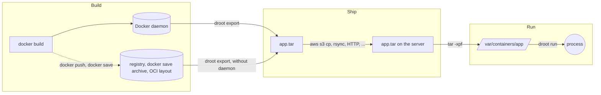
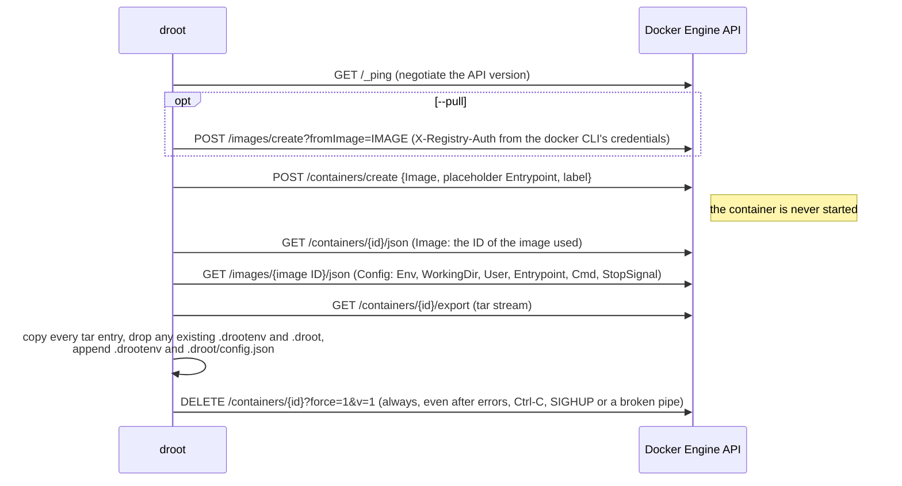

# How droot works

Droot splits the container workflow into three independent steps — Build,
Ship, Run — and only implements the parts Docker makes complicated:



## Source layout

All packages but `main` live under `internal/`: droot is a command, not a
library, and its packages carry no compatibility promise.

| Package | Role |
|---|---|
| `cmd/droot` | `main`: signal handling, version stamping. |
| `internal/cli` | A small command line parser: flags, help, suggestions for typos, shell completion scripts. |
| `internal/commands` | The commands: `export`, `run`, `umount`, `status`, `unshare`. |
| `internal/conffile` | The configuration files of `droot run --config`, a subset of TOML. |
| `internal/docker` | A minimal Docker Engine API client written with the standard library, and the export logic. |
| `internal/image` | Images read without daemon: a registry client, `docker save` archives, OCI layouts, and the flattening of layers. |
| `internal/environ` | Reading, validating and merging `KEY=VALUE` environment variables (`/.drootenv`, `--env-file`). |
| `internal/imageconfig` | The image configuration saved in `/.droot/config.json`. |
| `internal/identity` | Resolving `--user`/`--group` to uid, gid and supplementary groups. |
| `internal/mounter` | Mounting `/proc`, `/sys` and bind mounts, parsing `/proc/self/mountinfo`, unmounting. |
| `internal/osutil` | File system and process helpers: secure path resolution, file copy, devices, capabilities, credentials, exec. |
| `internal/seccomp` | The seccomp filter of `droot run --seccomp default`, a classic BPF program. |
| `internal/systemd` | The variables of systemd's notifications and socket activation that `droot run` passes on to `COMMAND`, and the relay of the notifications of a rootless `COMMAND`. |
| `internal/userns` | Rootless mode: the ID mappings, the start of droot in a user namespace, and its supervision. |
| `internal/log` | A tiny leveled logger writing to STDERR. |

Only one third-party module is used: `golang.org/x/sys`.

## `droot export`



Design notes:

- **No Docker SDK.** The `docker` package implements the seven endpoints above
  over HTTP with `net/http`, on a unix socket, TCP (optionally TLS) or the
  standard input and output of `ssh HOST docker system dial-stdio`. The
  daemon address is resolved like the `docker` CLI does (`DOCKER_HOST`,
  `DOCKER_CONTEXT`, current context, default socket).
- **API version.** droot uses the version advertised by the daemon in the
  `Api-Version` header of `/_ping` (or `DOCKER_API_VERSION`, falling back to
  1.41 when the daemon does not advertise one). `--platform` needs 1.41 or
  later. The endpoints
  droot needs have been stable for a decade, while pinning an old version
  breaks as daemons raise their minimum supported version (droot 0.7 pinned
  1.29, which current Docker releases reject).
- **The image is never run.** Older versions started the container to write
  `/.drootenv` with `/bin/sh -c 'echo ...'`, which required a shell in the
  image and broke (or was injectable) when values contained quotes, `$` or
  backquotes. The environment is now injected into the tar stream instead.
- **The environment comes from the image config** of the exact image the
  temporary container was created from (not from the container's config, to
  which Podman adds `container=podman`). droot 0.7 read the image's `ContainerConfig`, which
  BuildKit leaves empty and recent daemons do not return at all.
- **Temporary containers** carry the label `io.github.yuuki.droot=export`. If
  droot is killed with SIGKILL, leftovers can be removed with
  `docker rm $(docker ps -aq --filter label=io.github.yuuki.droot)`.

### Without daemon

For `docker://`, `docker-archive:`, `oci:` and `oci-archive:` images, the
`image` package replaces the daemon:

1. **Find the image.** A registry is asked for the manifest of the tag or
   digest (the token authentication of Docker registries, or basic
   authentication, with the credentials of the docker CLI, read only when
   the registry asks for them). An archive is indexed once, its files then
   read in place; `docker save` archives are read from their
   `manifest.json`, OCI layouts from `index.json`. A multi-platform index
   is resolved to the manifest of `--platform`, as containerd matches
   platforms (`linux/arm/v7` runs `v6` images, attestations are skipped).
2. **Download.** The layers of a registry are downloaded, three at a time,
   to `$TMPDIR`, retrying transient errors. Every blob is verified against
   its digest, and every layer, once decompressed (gzip; zstd with the
   `zstd` command), against the `diff_id` of the configuration.
3. **Flatten** in two passes over the layers. The first reads only the
   headers and builds the tree of the merged file system: whiteouts
   (`.wh.NAME`, `.wh..wh..opq`) delete what the layers below have, a file
   replaces a directory and its content, and each hard link is tied to the
   file it names at that moment. Paths are resolved in the tree as a
   container engine resolves them when it extracts a layer in a chroot: a
   file `lib/x` below a symlink `lib -> usr/lib` of a lower layer is
   `/usr/lib/x`. Entries that are not files (PAX global headers, ...) are
   left out, and names longer than Linux accepts are refused. The second pass writes the surviving
   entries in the order of the layers, a directory before its content (with
   the metadata of the layer that last created it), and a hard link whose
   file was later deleted or replaced as a copy of that file (kept in a
   temporary file between the passes).

The resulting tar stream goes through the same rewriting as the stream of a
container: `/.drootenv` and `/.droot/config.json`, `--exclude`,
`--reproducible`.

### Archive format

The archive is the plain `docker export` tar of the container's file system
(including the files Docker adds to every container such as `/.dockerenv`,
`/etc/hosts` and `/etc/resolv.conf`), or, without daemon, the flattened
layers of the image, plus `/.droot/config.json`, the image's configuration:

```json
{
  "Version": 1,
  "Image": "dockerfiles/app",
  "ImageID": "sha256:...",
  "Env": ["PATH=/usr/local/sbin:/usr/local/bin:/usr/sbin:/usr/bin:/sbin:/bin", "JAVA_OPTS=-Dfoo=bar -Dbaz=qux"],
  "WorkingDir": "/app",
  "User": "app",
  "Entrypoint": ["/app/bin/server"],
  "Cmd": ["--port=8080"],
  "StopSignal": "SIGTERM"
}
```

`Version` is incremented when the format changes incompatibly; droot ignores
fields it does not know. The environment is also written to `/.drootenv`,
which droot 0.7 reads:

```
PATH=/usr/local/sbin:/usr/local/bin:/usr/sbin:/usr/bin:/sbin:/bin
JAVA_OPTS=-Dfoo=bar -Dbaz=qux
```

One `KEY=VALUE` per line, everything after the first `=` being the value.
Blank lines and lines starting with `#` are ignored when reading. Variables
that would not be read back exactly (values containing newlines, keys
starting with `#` or surrounded by spaces) cannot be represented: they are
only in `/.droot/config.json`, with a warning at export time. When both files
exist, `droot run` takes the environment of `config.json` and applies
`/.drootenv` over it, so that edits to `/.drootenv` still take effect.

Extract archives as root with `tar -xpf` so that ownership, permissions and
setuid bits are preserved, inside a directory that only root can enter (see
[Security considerations](security.md#recommendations)).

## `droot run`

1. Validate the options and resolve `--root` to an absolute path without
   symlinks (which is how `/proc/self/mountinfo` reports mount points). Read
   `/.droot/config.json` and `/.drootenv` through `osutil.Root` (see below)
   for the defaults of COMMAND, `--user` and `--workdir` and the environment,
   and read the `--env-file`s on the host.
2. `--cp`: copy the host's `/etc/{group,passwd,resolv.conf,hosts}` into the
   root. Each destination is resolved with `osutil.Root`, which opens every
   path component with `openat(2)` and `O_NOFOLLOW` from the descriptor of its
   parent and follows symlinks *as if the root were `/`*. The file is written to
   a temporary file created in the resolved directory and renamed into place,
   so a malicious image — or a process of a container still running — cannot
   redirect the copy to a host file.
3. Resolve `--user`/`--group` with the root's `/etc/passwd` and `/etc/group`
   (then the host's). The primary group of the user is the default group and
   the supplementary groups are taken from the root's `/etc/group`.
4. Mount `proc` (nosuid, nodev, noexec) on `/proc`; recursively bind mount
   the host's `/sys` and make it an rslave mount; perform the bind mounts.
   Mount points are resolved with `osutil.Root`, created if missing (as a
   directory, or as an empty file for file bind mounts, with modes 0755 and
   0644 whatever the umask) and mounted on through
   `/proc/self/fd/N`, so the mount lands on the very directory that was
   resolved. Existing mounts are reused, so `run` can be repeated without
   `umount`. Every mount is made a slave mount, so mounts made inside the
   container never propagate back to the host. Read-only bind mounts are
   remounted with `MS_RDONLY` *plus* the nosuid/nodev/noexec/atime flags of
   the source, which a plain remount would clear. Last, a `NOTIFY_SOCKET`
   that is a path (systemd's `/run/systemd/notify`) is bind mounted
   read-only on the same path (not with `--no-systemd`; rootless, the
   socket of the relay of the supervising droot is bound there instead,
   see [Rootless](#rootless)), replacing the mount of a previous
   run unless it is the same socket. Nothing is mounted when a `--bind` or
   `--tmpfs` mounts on the path, or when the path already is what would be
   bound (a `--bind` of the directory of systemd's socket: a mount there
   would make the host's socket busy; rootless, the relay is mounted over
   it). The user did not ask for this mount, so its mount point is only
   created in directories of the container's own file systems
   (`Root.OpenMountTargetWithin`, `BindOptions.Within`,
   `mounter.OnContainerFS`): on `ROOT_DIR`'s own mount, or on a file system
   that `mountinfo` shows mounted nowhere but under `ROOT_DIR` (a
   `--tmpfs`, even reused from a previous run). A bind mount of a host
   directory, even of a host tmpfs, or one that a `--tmpfs` reuses, is
   refused, so the mount point is never left behind in a host directory.
   In the host's mount namespace, an existing mount point in such a
   directory is refused too (`BindOptions.WithinParent`): the mount would
   make the host's file busy. Without mount IDs in `fdinfo` (Linux before
   3.15), mounts are told apart by device, which misses a bind mount of a
   directory of `ROOT_DIR`'s own file system. A socket that cannot be
   bound (missing, or no mount point can be created) only gets a warning:
   droot may have inherited a `NOTIFY_SOCKET` meant for another process.
5. Create `/var/lock -> ../run/lock` if missing, and populate `/dev`: the
   device nodes `/dev/null` (1:3), `/dev/zero` (1:5), `/dev/full` (1:7),
   `/dev/random` (1:8), `/dev/urandom` (1:9) and `/dev/tty` (5:0), owned by
   root with mode 0666; the symlinks `/dev/fd`, `/dev/std{in,out,err}` and
   `/dev/ptmx -> pts/ptmx` (replacing a device node, which would allocate
   pseudo-terminals in the host's devpts instance); a new devpts instance
   (`newinstance,ptmxmode=0666,mode=0620,gid=5`) on `/dev/pts` and a tmpfs on
   `/dev/shm` — unless `/dev` is on another mount than the root (e.g. a bind
   mount of the host's `/dev`), in which case droot leaves it alone.
6. The goroutine was locked to its OS thread before the first mount. This
   matters: the capability bounding set is a per-thread attribute,
   `execve(2)` uses the calling thread's attributes, and the namespaces of
   `--unshare` are the thread's. Without the lock, the Go scheduler may run
   the `exec` on another thread than the one that dropped the capabilities.
   Before mounting, droot also takes an exclusive `flock(2)` on
   `/run/droot/DEV-INODE.lock`, named after the root directory (a lock on
   the directory itself could be held forever by any process able to open
   it, including the container's), released at the exec (the descriptor is
   close-on-exec), and
   with `--unshare` moves the thread to a new mount namespace whose mounts
   are slaves of the host's. Every mount droot makes is remembered by
   descriptor: if anything fails before the exec, they are detached again,
   newest first.
7. `chroot(2)` into the root and `chdir(2)` to the working directory.
8. Merge the environment: the image's, then the variables of systemd that
   are for droot (`NOTIFY_SOCKET`; `LISTEN_*` if `LISTEN_PID` is the PID of
   droot; `WATCHDOG_*` if `WATCHDOG_PID` is, or is unset; none with
   `--no-systemd`), then `--env-file`, then `--env`, plus the defaults of `PATH`, `HOME`, `USER`
   and `LOGNAME`. The sockets of socket activation are inherited: droot
   keeps them open, without close-on-exec, at descriptors 3, 4, ...
9. Drop every capability not in the keep list from the bounding set with
   `prctl(PR_CAPBSET_DROP)`, and empty the inheritable and ambient sets: the
   bounding set does not limit inheritable capabilities, which root keeps
   across `execve(2)` and which files with `+i` capabilities grant to any
   user.
10. `setgroups`, `setgid`, `setuid` (applied to all threads by the Go runtime),
    then `prctl(PR_SET_NO_NEW_PRIVS)` with `--no-new-privileges`.
11. Look up the command in the container's `PATH` with `access(X_OK)` checks
    done as the target user, and `execve(2)` it. droot is replaced by the
    command: no droot process remains, and exit codes and signals belong to
    the command.

Nothing is undone when the command exits: the mounts stay until
`droot umount`.

### Rootless

A `droot run` (or `droot unshare`) started by a user other than root goes
through the `userns` package first:

1. Read the user's subordinate IDs from `/etc/subuid` and `/etc/subgid`. The
   mapping is the user's own UID and GID as 0, then the subordinate ranges
   from 1 on — if the user has both, and `newuidmap` and `newgidmap` are
   installed; otherwise the user alone.
2. Start `/proc/self/exe` with the same arguments in a new user namespace
   (`CLONE_NEWUSER`, with `PR_SET_PDEATHSIG` set to `SIGKILL`). The child
   inherits the descriptors droot inherited without close-on-exec (the
   listening socket of server-starter, for instance) as they are, and so
   does the command. The sockets of socket activation (`LISTEN_FDS`, if
   `LISTEN_PID` is the PID of droot) are passed to the child at the same
   descriptors, 3, 4, ...; in the parent, they are close-on-exec, so that
   `newuidmap` and `newgidmap` do not inherit them. This first stage blocks
   on a pipe, inherited at its own number (given in the environment, rather
   than after the sockets, where it would take the place of an inherited
   descriptor), while the parent writes its ID maps: with
   `newuidmap`/`newgidmap`, or directly (`setgroups` denied, then a
   one-line `uid_map` and `gid_map`), which an unprivileged process may do
   for its own IDs.
3. Released, the first stage executes droot again: having become root of
   the namespace before this `execve(2)`, the second stage gets the
   capabilities of the namespace, re-arms the parent-death signal (cleared by
   the privilege change), takes over the sockets and the watchdog of the
   parent (`LISTEN_PID` and `WATCHDOG_PID`, if they are the parent's PID,
   become its own; `LISTEN_PIDFDID`, which names the parent's pidfd, is
   unset) and runs `droot run` as above, root of the
   namespace, with these differences: the mount namespace is always private
   (as with `--unshare`); procfs, which needs a PID namespace of its own
   there, is replaced by a recursive bind mount of the host's `/proc`; the
   device files are bind mounts of the host's; the devpts instance has no
   `gid=5` if the group `tty` is not mapped; the lock is
   `$XDG_RUNTIME_DIR/droot/DEV-INODE.lock`; unmapped supplementary groups
   are left out; and the parent-death signal is set again after `setuid`.
4. Meanwhile the parent, the first droot, keeps the thread that started the
   child (the parent-death signal follows the thread), passes `SIGHUP`,
   `SIGINT`, `SIGTERM`, `SIGQUIT`, `SIGUSR1`, `SIGUSR2`, ... on to it — from
   before the child is started — and exits with the exit status of
   `COMMAND`, or kills itself with the signal that killed it. Without a
   terminal, the child has a process group of its own, so that a signal
   sent to the group of droot (`timeout(1)`, `kill -- -PGID`) reaches it
   once; on a terminal, it stays in the group of droot for job control, and
   the signals the terminal sends to its foreground group are not passed
   on while droot is in the foreground. Under systemd, the parent stays
   the main process of the service, so it relays the notifications of
   `COMMAND`, its child (`systemd.Relay`), unless `--no-systemd` is given
   on the command line: before starting the child, it binds a datagram
   socket with `SO_PASSCRED` in a new 0700 directory of `$XDG_RUNTIME_DIR`,
   `$RUNTIME_DIRECTORY` or `$TMPDIR` (`/tmp`), named to the second stage by
   `_DROOT_USERNS_NOTIFY_RELAY` (the parent drops the `_DROOT_USERNS_*`
   variables it inherited; the second stage only takes a socket of the
   user, named like a relay, in a user namespace). The second stage bind
   mounts it read-only on the path of `NOTIFY_SOCKET` in the container
   instead of systemd's socket, then removes the socket and its directory
   from the host, bound or not (`--no-systemd` in `--config`, `--env
   NOTIFY_SOCKET=...`): a bind mount keeps working without its path. The
   parent forwards to systemd's socket, from itself, each datagram whose
   `SCM_CREDENTIALS` name `COMMAND` (those of its children are dropped, as
   `NotifyAccess=main` would), with the descriptors it carries
   (`SCM_RIGHTS`: `FDSTORE=1`, `BARRIER=1`), which it then closes, and
   without its `MAINPID=`, `MAINPIDFD=` and `MAINPIDFDID=` lines (split at
   `\n` and `\r`, like systemd). A send waits 2 seconds at most for room
   in systemd's queue. Once `COMMAND` has exited, the parent leaves it a
   zombie (`waitid(WNOWAIT)`), so that its PID cannot be reused, relays
   what is still queued for 5 seconds at most, then reaps it. Without a
   writable directory for the relay, the second stage binds systemd's
   socket, with a warning: the notifications then need
   `NotifyAccess=all`.

Run rootless, droot re-executes itself before reading anything: `--config`
and `--env-file` may be pipes, which only the second stage must read.

## `droot umount`

Reads `/proc/self/mountinfo`, selects the mount points below `root + "/"` (so
`/var/containers/app2` is not affected by `--root /var/containers/app`, and
the root itself, which may be a file system of its own, is kept) and sorts
them deepest first. Each mount point
is then opened from the root with `osutil.Root` *without following any
symlink*, and unmounted with `MNT_DETACH` through `/proc/self/fd/N` only if
the descriptor belongs to the mount listed in mountinfo (same mount ID). A
process in the container therefore cannot redirect the unmount to a host
mount by replacing a directory with a symlink. Mount points already
detached together with their parent are ignored, which makes the command
idempotent. A mount hidden by another one becomes reachable once the other
is gone, so this is repeated until nothing is left; if some mounts cannot be
reached (e.g. something is mounted over the root itself), the command fails
and lists them.
