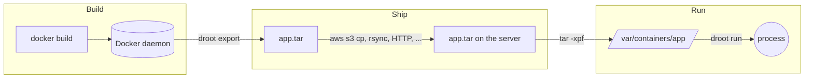
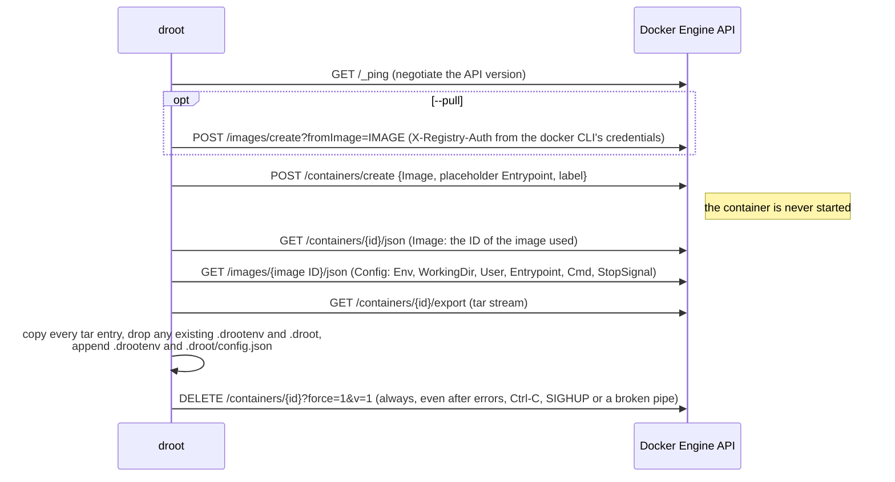

# How droot works

Droot splits the container workflow into three independent steps — Build,
Ship, Run — and only implements the parts Docker makes complicated:



## Source layout

All packages but `main` live under `internal/`: droot is a command, not a
library, and its packages carry no compatibility promise.

| Package | Role |
|---|---|
| `cmd/droot` | `main`: signal handling, version stamping. |
| `internal/cli` | A small command line parser: flags, help, suggestions for typos, shell completion scripts. |
| `internal/commands` | The commands: `export`, `run`, `umount`. |
| `internal/docker` | A minimal Docker Engine API client written with the standard library, and the export logic. |
| `internal/environ` | Reading, validating and merging `KEY=VALUE` environment variables (`/.drootenv`, `--env-file`). |
| `internal/imageconfig` | The image configuration saved in `/.droot/config.json`. |
| `internal/identity` | Resolving `--user`/`--group` to uid, gid and supplementary groups. |
| `internal/mounter` | Mounting `/proc`, `/sys` and bind mounts, parsing `/proc/self/mountinfo`, unmounting. |
| `internal/osutil` | File system and process helpers: secure path resolution, file copy, devices, capabilities, credentials, exec. |
| `internal/log` | A tiny leveled logger writing to STDERR. |

Only one third-party module is used: `golang.org/x/sys`.

## `droot export`



Design notes:

- **No Docker SDK.** The `docker` package implements the seven endpoints above
  over HTTP with `net/http`, on a unix socket, TCP (optionally TLS) or the
  standard input and output of `ssh HOST docker system dial-stdio`. The
  daemon address is resolved like the `docker` CLI does (`DOCKER_HOST`,
  `DOCKER_CONTEXT`, current context, default socket).
- **API version.** droot uses the version advertised by the daemon in the
  `Api-Version` header of `/_ping` (or `DOCKER_API_VERSION`, falling back to
  1.41 when the daemon does not advertise one). `--platform` needs 1.41 or
  later. The endpoints
  droot needs have been stable for a decade, while pinning an old version
  breaks as daemons raise their minimum supported version (droot 0.7 pinned
  1.29, which current Docker releases reject).
- **The image is never run.** Older versions started the container to write
  `/.drootenv` with `/bin/sh -c 'echo ...'`, which required a shell in the
  image and broke (or was injectable) when values contained quotes, `$` or
  backquotes. The environment is now injected into the tar stream instead.
- **The environment comes from the image config** of the exact image the
  temporary container was created from (not from the container's config, to
  which Podman adds `container=podman`). droot 0.7 read the image's `ContainerConfig`, which
  BuildKit leaves empty and recent daemons do not return at all.
- **Temporary containers** carry the label `io.github.yuuki.droot=export`. If
  droot is killed with SIGKILL, leftovers can be removed with
  `docker rm $(docker ps -aq --filter label=io.github.yuuki.droot)`.

### Archive format

The archive is the plain `docker export` tar of the container's file system
(including the files Docker adds to every container such as `/.dockerenv`,
`/etc/hosts` and `/etc/resolv.conf`), plus `/.droot/config.json`, the
image's configuration:

```json
{
  "Version": 1,
  "Image": "dockerfiles/app",
  "ImageID": "sha256:...",
  "Env": ["PATH=/usr/local/sbin:/usr/local/bin:/usr/sbin:/usr/bin:/sbin:/bin", "JAVA_OPTS=-Dfoo=bar -Dbaz=qux"],
  "WorkingDir": "/app",
  "User": "app",
  "Entrypoint": ["/app/bin/server"],
  "Cmd": ["--port=8080"],
  "StopSignal": "SIGTERM"
}
```

`Version` is incremented when the format changes incompatibly; droot ignores
fields it does not know. The environment is also written to `/.drootenv`,
which droot 0.7 reads:

```
PATH=/usr/local/sbin:/usr/local/bin:/usr/sbin:/usr/bin:/sbin:/bin
JAVA_OPTS=-Dfoo=bar -Dbaz=qux
```

One `KEY=VALUE` per line, everything after the first `=` being the value.
Blank lines and lines starting with `#` are ignored when reading. Variables
that would not be read back exactly (values containing newlines, keys
starting with `#` or surrounded by spaces) cannot be represented: they are
only in `/.droot/config.json`, with a warning at export time. When both files
exist, `droot run` takes the environment of `config.json` and applies
`/.drootenv` over it, so that edits to `/.drootenv` still take effect.

Extract archives as root with `tar -xpf` so that ownership, permissions and
setuid bits are preserved.

## `droot run`

1. Validate the options and resolve `--root` to an absolute path without
   symlinks (which is how `/proc/self/mountinfo` reports mount points). Read
   `/.droot/config.json` and `/.drootenv` through `osutil.Root` (see below)
   for the defaults of COMMAND, `--user` and `--workdir` and the environment,
   and read the `--env-file`s on the host.
2. `--cp`: copy the host's `/etc/{group,passwd,resolv.conf,hosts}` into the
   root. Each destination is resolved with `osutil.Root`, which opens every
   path component with `openat(2)` and `O_NOFOLLOW` from the descriptor of its
   parent and follows symlinks *as if the root were `/`*. The file is written to
   a temporary file created in the resolved directory and renamed into place,
   so a malicious image — or a process of a container still running — cannot
   redirect the copy to a host file.
3. Resolve `--user`/`--group` with the root's `/etc/passwd` and `/etc/group`
   (then the host's). The primary group of the user is the default group and
   the supplementary groups are taken from the root's `/etc/group`.
4. Mount `proc` (nosuid, nodev, noexec) on `/proc`; recursively bind mount
   the host's `/sys` and make it an rslave mount; perform the bind mounts.
   Mount points are resolved with `osutil.Root`, created if missing (as a
   directory, or as an empty file for file bind mounts) and mounted on through
   `/proc/self/fd/N`, so the mount lands on the very directory that was
   resolved. Existing mounts are reused, so `run` can be repeated without
   `umount`. Every mount is made a slave mount, so mounts made inside the
   container never propagate back to the host. Read-only bind mounts are
   remounted with `MS_RDONLY` *plus* the nosuid/nodev/noexec/atime flags of
   the source, which a plain remount would clear.
5. Create `/var/lock -> ../run/lock` if missing, and populate `/dev`: the
   device nodes `/dev/null` (1:3), `/dev/zero` (1:5), `/dev/full` (1:7),
   `/dev/random` (1:8), `/dev/urandom` (1:9) and `/dev/tty` (5:0), owned by
   root with mode 0666; the symlinks `/dev/fd`, `/dev/std{in,out,err}` and
   `/dev/ptmx -> pts/ptmx` (replacing a device node, which would allocate
   pseudo-terminals in the host's devpts instance); a new devpts instance
   (`newinstance,ptmxmode=0666,mode=0620,gid=5`) on `/dev/pts` and a tmpfs on
   `/dev/shm` — unless `/dev` is on another mount than the root (e.g. a bind
   mount of the host's `/dev`), in which case droot leaves it alone.
6. The goroutine was locked to its OS thread before the first mount. This
   matters: the capability bounding set is a per-thread attribute,
   `execve(2)` uses the calling thread's attributes, and the namespaces of
   `--unshare` are the thread's. Without the lock, the Go scheduler may run
   the `exec` on another thread than the one that dropped the capabilities.
   Before mounting, droot also takes an exclusive `flock(2)` on
   `/run/droot/DEV-INODE.lock`, named after the root directory (a lock on
   the directory itself could be held forever by any process able to open
   it, including the container's), released at the exec (the descriptor is
   close-on-exec), and
   with `--unshare` moves the thread to a new mount namespace whose mounts
   are slaves of the host's. Every mount droot makes is remembered by
   descriptor: if anything fails before the exec, they are detached again,
   newest first.
7. `chroot(2)` into the root and `chdir(2)` to the working directory.
8. Merge the environment: the image's, then `--env-file`, then `--env`, plus
   the defaults of `PATH`, `HOME`, `USER` and `LOGNAME`.
9. Drop every capability not in the keep list from the bounding set with
   `prctl(PR_CAPBSET_DROP)`, and empty the inheritable and ambient sets: the
   bounding set does not limit inheritable capabilities, which root keeps
   across `execve(2)` and which files with `+i` capabilities grant to any
   user.
10. `setgroups`, `setgid`, `setuid` (applied to all threads by the Go runtime),
    then `prctl(PR_SET_NO_NEW_PRIVS)` with `--no-new-privileges`.
11. Look up the command in the container's `PATH` with `access(X_OK)` checks
    done as the target user, and `execve(2)` it. droot is replaced by the
    command: no droot process remains, and exit codes and signals belong to
    the command.

Nothing is undone when the command exits: the mounts stay until
`droot umount`.

## `droot umount`

Reads `/proc/self/mountinfo`, selects the mount points below `root + "/"` (so
`/var/containers/app2` is not affected by `--root /var/containers/app`, and
the root itself, which may be a file system of its own, is kept) and sorts
them deepest first. Each mount point
is then opened from the root with `osutil.Root` *without following any
symlink*, and unmounted with `MNT_DETACH` through `/proc/self/fd/N` only if
the descriptor belongs to the mount listed in mountinfo (same mount ID). A
process in the container therefore cannot redirect the unmount to a host
mount by replacing a directory with a symlink. Mount points already
detached together with their parent are ignored, which makes the command
idempotent. A mount hidden by another one becomes reachable once the other
is gone, so this is repeated until nothing is left; if some mounts cannot be
reached (e.g. something is mounted over the root itself), the command fails
and lists them.
