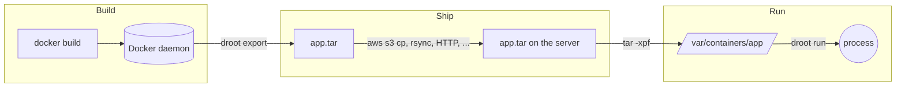
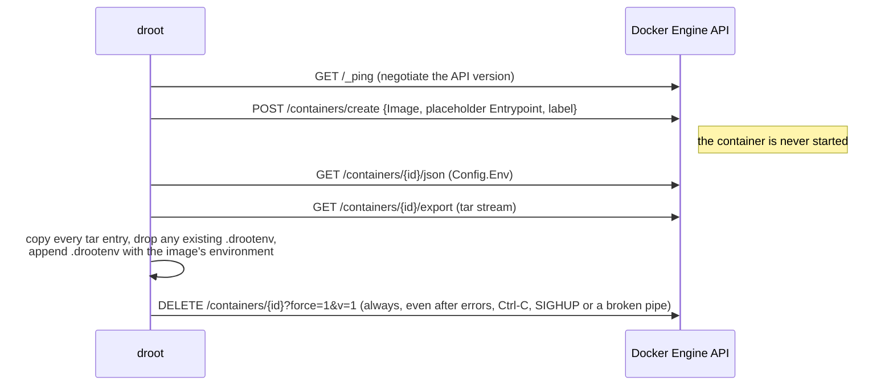

# How droot works

Droot splits the container workflow into three independent steps — Build,
Ship, Run — and only implements the parts Docker makes complicated:



## Source layout

| Package | Role |
|---|---|
| `cmd/droot` | `main`: signal handling, version stamping. |
| `commands` | The CLI (urfave/cli v3): `export`, `run`, `umount`. |
| `docker` | A minimal Docker Engine API client written with the standard library, and the export logic. |
| `environ` | Reading, validating and merging `KEY=VALUE` environment variables (`/.drootenv`). |
| `identity` | Resolving `--user`/`--group` to uid, gid and supplementary groups. |
| `mounter` | Mounting `/proc`, `/sys` and bind mounts, parsing `/proc/self/mountinfo`, unmounting. |
| `osutil` | File system and process helpers: secure path resolution, file copy, devices, capabilities, credentials, exec. |
| `log` | A tiny leveled logger writing to STDERR. |

Only two third-party modules are used: `github.com/urfave/cli/v3` and
`golang.org/x/sys`.

## `droot export`



Design notes:

- **No Docker SDK.** The `docker` package implements the five endpoints above
  over HTTP with `net/http`, on a unix socket or TCP (optionally TLS). The
  daemon address is resolved like the `docker` CLI does (`DOCKER_HOST`,
  `DOCKER_CONTEXT`, current context, default socket).
- **API version.** droot uses the version advertised by the daemon in the
  `Api-Version` header of `/_ping` (or `DOCKER_API_VERSION`, falling back to
  1.41 when the daemon does not advertise one). `--platform` needs 1.41 or
  later. The endpoints
  droot needs have been stable for a decade, while pinning an old version
  breaks as daemons raise their minimum supported version (droot 0.7 pinned
  1.29, which current Docker releases reject).
- **The image is never run.** Older versions started the container to write
  `/.drootenv` with `/bin/sh -c 'echo ...'`, which required a shell in the
  image and broke (or was injectable) when values contained quotes, `$` or
  backquotes. The environment is now injected into the tar stream instead.
- **The environment comes from the container's config**, which Docker merges
  from the image config. droot 0.7 read the image's `ContainerConfig`, which
  BuildKit leaves empty and recent daemons do not return at all.
- **Temporary containers** carry the label `io.github.yuuki.droot=export`. If
  droot is killed with SIGKILL, leftovers can be removed with
  `docker rm $(docker ps -aq --filter label=io.github.yuuki.droot)`.

### Archive format

The archive is the plain `docker export` tar of the container's file system
(including the files Docker adds to every container such as `/.dockerenv`,
`/etc/hosts` and `/etc/resolv.conf`), plus `/.drootenv`:

```
PATH=/usr/local/sbin:/usr/local/bin:/usr/sbin:/usr/bin:/sbin:/bin
JAVA_OPTS=-Dfoo=bar -Dbaz=qux
```

One `KEY=VALUE` per line, everything after the first `=` being the value.
Blank lines and lines starting with `#` are ignored when reading. Values
containing newlines cannot be represented and are skipped with a warning at
export time.

Extract archives as root with `tar -xpf` so that ownership, permissions and
setuid bits are preserved.

## `droot run`

1. Validate the options and resolve `--root` to an absolute path without
   symlinks (which is how `/proc/self/mountinfo` reports mount points).
2. `--cp`: copy the host's `/etc/{group,passwd,resolv.conf,hosts}` into the
   root. Each destination is resolved with `osutil.Root`, which opens every
   path component with `openat(2)` and `O_NOFOLLOW` from the descriptor of its
   parent and follows symlinks *as if the root were `/`*. The file is written to
   a temporary file created in the resolved directory and renamed into place,
   so a malicious image — or a process of a container still running — cannot
   redirect the copy to a host file.
3. Resolve `--user`/`--group` with the root's `/etc/passwd` and `/etc/group`
   (then the host's). The primary group of the user is the default group and
   the supplementary groups are taken from the root's `/etc/group`.
4. Mount `proc` (nosuid, nodev, noexec) on `/proc`; recursively bind mount
   the host's `/sys` and make it an rslave mount; perform the bind mounts.
   Mount points are resolved with `osutil.Root`, created if missing (as a
   directory, or as an empty file for file bind mounts) and mounted on through
   `/proc/self/fd/N`, so the mount lands on the very directory that was
   resolved. Existing mounts are
   reused, so `run` can be repeated without `umount`. Every mount is made a
   slave mount, so mounts made inside the container never propagate back to
   the host. Read-only bind mounts are
   remounted with `MS_RDONLY` *plus* the nosuid/nodev/noexec/atime flags of
   the source, which a plain remount would clear.
5. Create `/var/lock -> ../run/lock` if missing, and the device nodes
   `/dev/null` (1:3), `/dev/zero` (1:5), `/dev/random` (1:8) and
   `/dev/urandom` (1:9), owned by root with mode 0666 — unless `/dev` is on
   another mount than the root (e.g. a bind mount of the host's `/dev`), in
   which case droot leaves it alone.
6. Lock the goroutine to its OS thread. This matters: the capability bounding
   set is a per-thread attribute and `execve(2)` uses the calling thread's
   attributes. Without the lock, the Go scheduler may run the `exec` on
   another thread than the one that dropped the capabilities.
7. `chroot(2)` into the root and `chdir("/")`.
8. Read `/.drootenv` (now inside the root) and merge `--env` over it.
9. Drop every capability not in the keep list from the bounding set with
   `prctl(PR_CAPBSET_DROP)`, and empty the inheritable and ambient sets: the
   bounding set does not limit inheritable capabilities, which root keeps
   across `execve(2)` and which files with `+i` capabilities grant to any
   user.
10. `setgroups`, `setgid`, `setuid` (applied to all threads by the Go runtime),
    then `prctl(PR_SET_NO_NEW_PRIVS)` with `--no-new-privileges`.
11. Look up the command in the container's `PATH` with `access(X_OK)` checks
    done as the target user, and `execve(2)` it. droot is replaced by the
    command: no droot process remains, and exit codes and signals belong to
    the command.

Nothing is undone when the command exits: the mounts stay until
`droot umount`.

## `droot umount`

Reads `/proc/self/mountinfo`, selects the mount points below `root + "/"` (so
`/var/containers/app2` is not affected by `--root /var/containers/app`, and
the root itself, which may be a file system of its own, is kept) and sorts
them deepest first. Each mount point
is then opened from the root with `osutil.Root` *without following any
symlink*, and unmounted with `MNT_DETACH` through `/proc/self/fd/N` only if
the descriptor belongs to the mount listed in mountinfo (same mount ID). A
process in the container therefore cannot redirect the unmount to a host
mount by replacing a directory with a symlink. Mount points already
detached together with their parent are ignored, which makes the command
idempotent. A mount hidden by another one becomes reachable once the other
is gone, so this is repeated until nothing is left; if some mounts cannot be
reached (e.g. something is mounted over the root itself), the command fails
and lists them.
